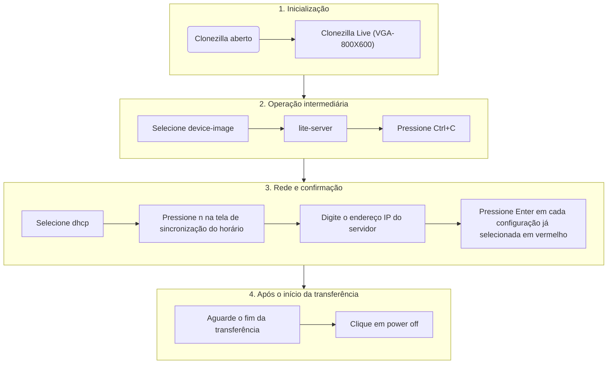

# [Instalar SO's e realizar snapshots de um máquina virtual VMware — UC 3]

* **Aluno:** Helvecio Resende Chaves
* **Tema:** Clonando ISOs em massa via clonagem remota a partir rede em modo bridge
## 1. Objetivo
- Instalar ISOs de uma máquina em várias máquinas cliente a partir de uma clonagem remota utilizando o modo multicast de transmissão de dados numa rede com conexão do tipo bridge. 
## 2. Ferramentas e Cuidados Técnicos
### **Ferramentas / Softwares:** 
- Clonezzila
- Servidor que fornecerá a ISO remotamente
- Computadores clientes que receberão as imagens ISO
### **Segurança / Boas Práticas:** 
- Backup prévio da ISO da máquina que irá ser clonada (evita perda caso o disposito estrague ou o arquivo original corrompa)
- Verificação de energia (se possível garanta um ambiente de rede que não está sujeito à variações bruscas/falta de energia elétrica, pois desligar as máquinas durante o processo pode corromper os arquivos)
- As máquinas devem ter um espaço igual ou superior ao tamanho máximo do arquivo descompactado 
## 3. Passo a Passo
### Boot do Sistema Operacional de Backup
- No menu BIOS ou UEFI do computador selecione o dispostivo de armazenamento que possui o arquivo ISO do Clonezilla como meio principal de boot
- Saia do menu BIOS ou UEFI
- Ao fazer o boot automático do disposito selecionado, selecione a primeira opção ao abrir o Clonezilla "English"
- Pressione Enter na opção "Keep default keyboard layout (US)"
- Pressione Enter na opção "Start Clonezilla"
----
#### Representação esquemática do processo dentro do Clonezilla:

## 4. Como Validar (Teste Final)
- Ligue a máquina e veja se o sistema está rodando normalmente
